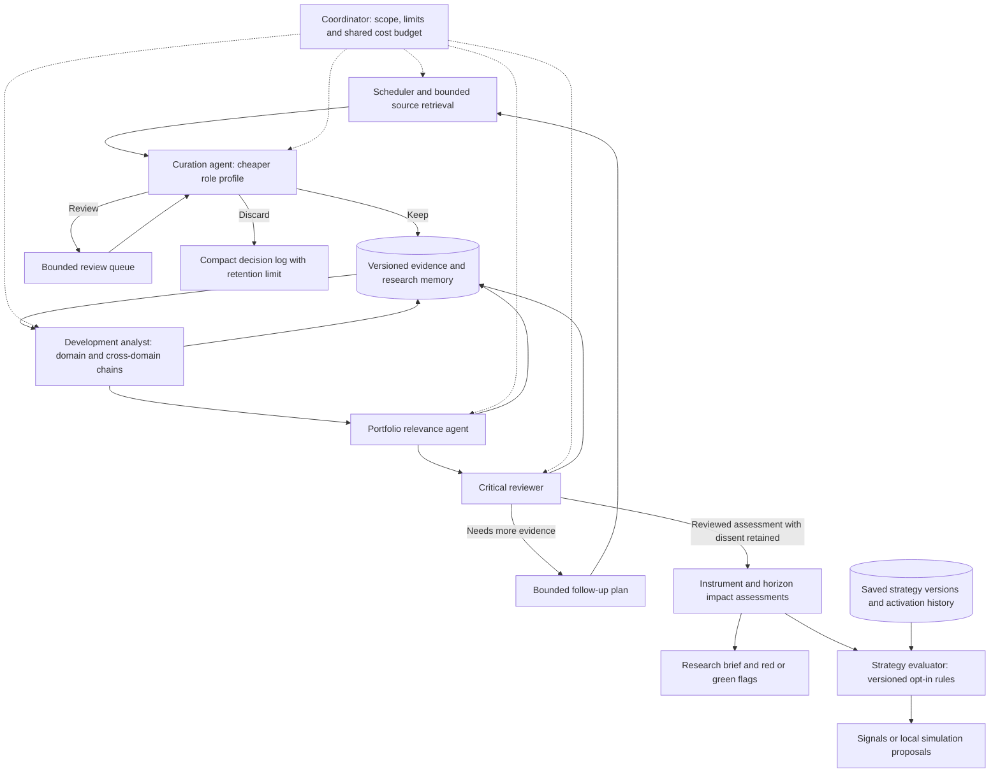

# Architecture

The application is a modular Python monolith with a React/Vite frontend, FastAPI, SQLAlchemy/Alembic, SQLite and bounded local workers. Python and SQLite are the user's selected runtime. PostgreSQL, Chroma services, Celery/Redis and a separate external broker executor remain deferred parts of the original broader design.

## Running now

- FastAPI serves the built React client and versioned `/api/v1` routes. Explicit Pydantic response models filter serialized data; TypeScript response types are generated from OpenAPI. The standard verification command checks for generated-type drift.
- SQLAlchemy persists users, hashed sessions, instruments, watchlists, evidence events, immutable strategy versions, jobs, accounts, proposals, fills, annotations, notifications, and audit events. Workspace settings, their revisions, monthly budgets, cost entries, cost revisions and recurring commitments use separate tables. Research domains, collection settings/sources/runs, stable source documents, immutable document revisions and import idempotency records are persisted separately from the synthetic event fixtures.
- SQLite WAL is used by explicit preference. Account compare-and-swap updates protect approval races. A short write transaction on the workspace singleton serializes cost admission, reconciliation and settings changes before balances are read. A separate gathering singleton serializes collection claims, source configuration and source-library imports.
- The numerical in-process worker executes vectorbt or a deterministic LangGraph research graph. Jobs capture their exact bars/specification or research evidence, information cutoff and workspace settings before scheduling. Workers conditionally claim pending jobs and verify the input hash. Interrupted running work becomes failed with an explanation; pending work resumes only with valid frozen inputs.
- A separate single-thread feed worker retrieves enabled public sources. The in-process schedule checks due sources, coalesces missed intervals and retries persisted queued claims after transient failures. Interrupted running collections fail honestly; eligible queued work can resume after restart. New requests stop during shutdown, while an already in-flight request can finish.
- React Query fetches and invalidates server state. TanStack Router handles the workbench and Help navigation. Lightweight Charts v5 renders fictional daily prices, volume and indicators; Radix Dialog provides accessible forms and detail views. The static `docs/user-guide.html` is served locally at `/help/user-guide.html` and embedded in the Help page.

## Workspace configuration and operating costs

The owner can change market scope, default horizon and the shared monthly operating allowance. The initial configuration includes US and European equities, days-to-weeks research, and EUR 20 per month. These are saved preferences, not evidence of active real-data coverage. Horizon is distinct from the chart interval and does not create intraday data. New strategy versions retain their chosen horizon, while new runs capture settings and their revision. Later changes never rewrite a saved run; older strategies without horizon metadata remain unspecified.

The cost service supports manual confirmed/estimated expenses, unknown charges, bounded reservations and recurring monthly commitments. Decimal arithmetic converts values to integer micro-EUR storage while retaining original currency, pricing and FX provenance. Reservation checks include known expenses, commitments and unresolved prior-month holds against one workspace-wide budget. Unknown costs block further paid admission. Reconciliation is idempotent and appends revision history; a late invoice can exceed the allowance, but cannot raise it automatically.

Recurring records reserve their configured amount once per calendar month and can stop future renewals in the local ledger. They neither purchase nor cancel an external subscription. Paid-provider integrations are disconnected, so automatic provider usage/billing synchronization is not claimed. Public-feed collection retrieves unauthenticated publisher material and makes no model calls. Future paid adapters must reserve a bounded amount before making an external call and reconcile afterwards, outside the database transaction.

The cost-impact report compares the signed-in user's reconstructed local-demo realized P&L with the full shared workspace operating expenses for the selected month. It is labelled as an illustrative scenario, not live profit or a per-user cost allocation. Unrealized P&L is shown separately, and incomplete costs or an unreconciled ledger prevent a complete net result. Run-level cost views show attributed records only.

## Public-source gathering and historical context

Research & events has separate Source library, Gathering setup and Demo research views. The shared initial research interests are Nvidia, Amazon, Macroeconomics and Geopolitics; they are topic metadata, not real trading instruments. The owner can add/edit interests, assign reviewed public feeds to several domains, choose intervals and control collection. The six-source catalog covers NVIDIA, AWS, the Federal Reserve, ECB, EU Council and EIA. The starter plan is hourly collection of the first five; configuration/activation and successful retrieval are separate runtime facts, not assumed by the catalog.

The collection path requires process permission plus workspace, source and active-domain gates. Fresh seeds leave collection off and sources unconfigured. Public URLs come from the reviewed catalog, never a caller-supplied fetch endpoint. The fetcher has bounded time/download/item/XML limits, rejects redirects and unsafe XML, strips markup to plain source text and records errors without substituting fictional data. No credentials, article-page scraping, paid search or LLM analysis is involved. Source assignments express configured coverage; no classifier yet determines causal relevance.

A collection claim commits before network work begins. Its persisted snapshot records the exact catalog endpoint, source/settings revisions and active domain scope. A later catalog URL change fails the queued request rather than fetching under a different saved identity. One active run per source and conditional status transitions prevent duplicate execution. SQLite ingestion commits its new documents/revisions and run outcome atomically. Raw parsed publisher fields, including uncertain date strings, remain available alongside normalized values and the feed response hash.

The source library retains stable source/publication identities and appends revisions when stored content or attribution changes. RSS collection and explicit manual historical imports use distinct provenance. Publication time, calendar-date-only precision, optional event time and actual first observation are separate fields. An archive imported today remains newly observed today. SQL queries select the latest revision eligible at the requested knowledge cutoff before applying source/domain/content filters and pagination; detail/export uses that same cutoff. This makes stored evidence history inspectable without claiming that newly imported history was available to the app in the past.

Source documents are the foundation for future longitudinal analysis. They are not automatically promoted to verified events or injected into the existing fixture research graph. Evidence-to-event synthesis, cross-publisher semantic grouping, corrections/retractions at the event level, premium analyst/critic workflows and fully isolated historical LLM evaluation remain future work.

## Planned multi-agent research and strategy bridge (FB08)

This is the target structure documented after FB07, not an implemented agent pipeline. The FB06 runtime retrieves public feeds and stores source revisions; it has no semantic Keep/Review/Discard gate, paid model execution, development-chain analysis, portfolio impact flags or strategy activation service. Its notebook saves and backtests versions of one SMA-crossover family. The proposed contracts are described in [data-contracts.md](data-contracts.md); product choices remain in [product-decisions.md](product-decisions.md).

### Responsibilities and shared memory

| Component | Responsibility | Limits and retained output |
| --- | --- | --- |
| Retrieval and scheduler | Fetch permitted material on configured schedules; coalesce missed work and enforce provider/time/size limits | Ordinary code handles downloads. A scheduled check is not itself an AI interpretation or market trigger |
| Curation agent | Judge credibility, novelty and direct/indirect relevance before choosing Keep, Review or Discard | Use a cheaper model profile where useful, retain reasons and policy/model versions, and never reject solely because no watched company is named. Review queues and discarded-item metadata have bounded retention; accepted evidence history is preserved |
| Development analyst | Connect new material with prior observations and open hypotheses within and across domains | Store observed facts separately from inferred links and possible outcomes; attach evidence, assumptions, counterevidence, uncertainty and expected delays to each link. Revisit changed or due hypotheses instead of producing disconnected daily summaries |
| Portfolio relevance agent | Evaluate the development chain against dated holdings, interests, exposures and horizons | Distinguish actual holdings, local-demo holdings and candidate instruments. Keep unknown exposure explicit; record possible risks/opportunities, materiality, timing and missing evidence. No present portfolio relevance need not erase a useful global hypothesis |
| Critical reviewer | Challenge the chain and its portfolio interpretation before a reviewed assessment is exposed to strategies | Inspect source support, independence, alternative explanations, missing links and unsupported claims about market pricing. Preserve objections and incomplete reviews. Separate agents agreeing is not independent factual confirmation |
| Coordinator | Schedule bounded work, select the configured role profiles and admit costs | Freeze inputs/settings, cap follow-up depth and revision rounds, reserve cost before paid attempts and retain uncertain usage. Budget limits pause work rather than silently downgrade premium roles or raise the allowance |

Domain agents are domain-scoped work units and configurable profiles in the local application, not a permanently running process for every topic. Shared company/entity identities and evidence allow several domains to contribute to one chain without fetching or charging for the same source repeatedly. Cross-domain synthesis must retain the originating evidence and explain the link rather than relying exclusively on compressed domain summaries.

Shared memory holds source revisions, curation decisions, dated hypotheses/connections, portfolio snapshots, critiques, impact assessments and eventual outcomes. Relevant history is retrieved for a task rather than copying the whole archive into every model call. Observation time and the later discovery of a relationship remain separate: a connection inferred today cannot appear in yesterday's historical strategy inputs. The same chain can strengthen, weaken, expire or remain unresolved; opportunities and delayed effects belong alongside threats.

Curation is a planned addition, not permission to purge the current source library. Retention for the candidate inbox, Review queue and discard logs must be explicit. Missing or failed model output remains pending/failed triage, never an inferred Discard decision. Sample rejected material to check for missed early signals. Accepted evidence already used by a hypothesis or strategy retains its provenance and revisions when focus changes.

### Strategy organisation and the impact interface

The target strategy workflow is **set up → save an immutable version → test that version → compare/change via a new version → explicitly activate or deactivate a version**. Strategy identity, algorithm-family definition, saved version, test run and activation history are separate objects. Testing records evidence; a completed or profitable test is not automatic activation or proof of live performance. Initially, activation selects monitoring/signals or an explicitly configured local-simulation mode, never broker permission. Editing an active strategy creates a draft version and leaves the active version unchanged until an explicit switch. Deactivation stops new strategy-driven signal actions while preserving history; an in-flight calculation may save its result but must recheck activation before emitting actionable work. It does not silently liquidate positions or cancel existing orders.

The first integration is advisory. Research produces a structured assessment for an instrument and effect horizon; the user sees evidence-backed flags. Formal strategy rules may later opt into research filters, such as declining a new long entry when a current adverse assessment meets the saved criteria. The LLM does not rewrite strategy rules or issue orders. The deterministic evaluator records the exact strategy version, eligible assessment revisions, prices, cutoff and configuration used for each decision. Multiple active strategies require explicit conflict and shared-capital rules rather than independently spending the same capacity.

Flag colour describes the assessed effect on the underlying instrument for the stated horizon: **red = adverse/downward**, **green = favourable/upward**. A reviewed assessment of **no material impact** creates no impact flag. Unassessed, insufficient-evidence and stale/expired states also lack a current directional flag, but must be shown as separate coverage/status information; no flag cannot be interpreted as proof of neutrality. Colour must have a text label and explanation.

Underlying direction and strategy applicability are different fields. An adverse price assessment can support a short strategy and oppose a long strategy, so the instrument's red flag must not silently change colour to mean “good for this strategy.” Record support/conflict/unknown applicability separately. Preserve competing supported red and green factors and their horizons with a Mixed status rather than inventing a net score; uncertain direction alone does not justify both flags. Criteria for materiality, freshness, expiry, reassessment and alert cooldowns must be versioned and tested before automated use; portfolio exposure, a plausible economic effect and a tradable price advantage are distinct conclusions.

## Boundaries

Quant functions and the ledgers have no LLM dependency. The research graph cannot approve orders. API sessions enforce account ownership and CSRF; only the workspace owner can mutate shared settings, cost records and gathering configuration/source imports. The partner can inspect shared costs, domains and source history while private trading accounts and numerical/research runs remain scoped to their owner. The external order path does not exist in this release; LIVE and non-DEMO startup are rejected. Merely adding secrets or increasing the budget cannot cause paid calls.

This runtime remains one application process with separate bounded numerical and feed workers, not a distributed worker deployment. Browser acceptance uses its own SQLite database, dotenv-free environment, explicit public-network disablement and uniquely identified loopback server; it never targets the interactive preview's database or process record.

## Prepared, not completed

Compose remains optional, unverified deployment preparation. The application does not yet use Redis, a Chroma index, Celery or PostgreSQL graph checkpoints. Real US/European equity-price feeds and listings, paid-provider activation and usage collection, archive connectors, synthesized event history, full chart tools, fully isolated historical training and richer execution simulation remain pending. Public-source document ingestion/revisions and a local collection schedule are implemented; selectable LLM profiles and paid analysis are still specifications. The client fetch helper still uses caller-supplied response types; generated types do not yet infer every route/request pairing. Do not claim the full target stack has been integrated.
